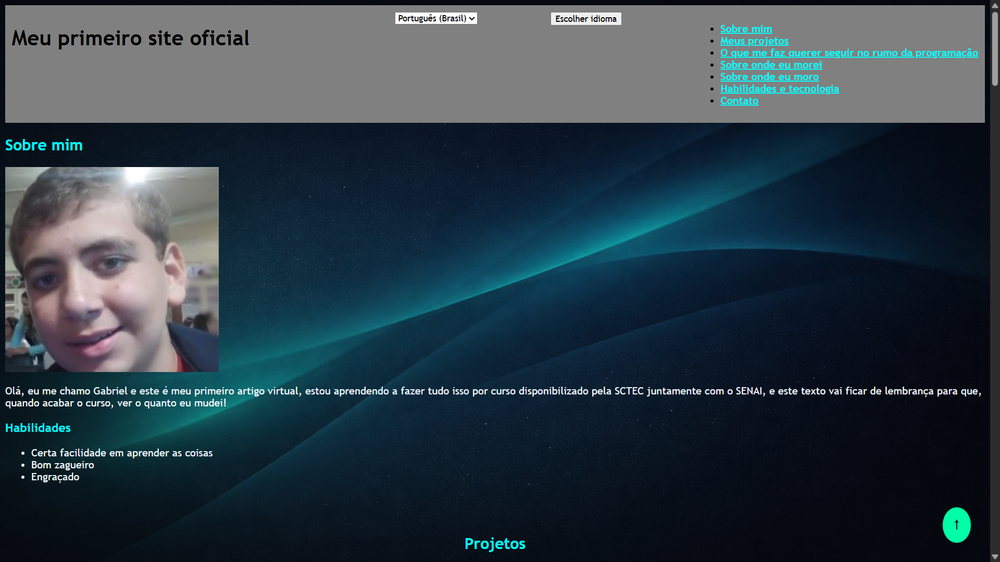
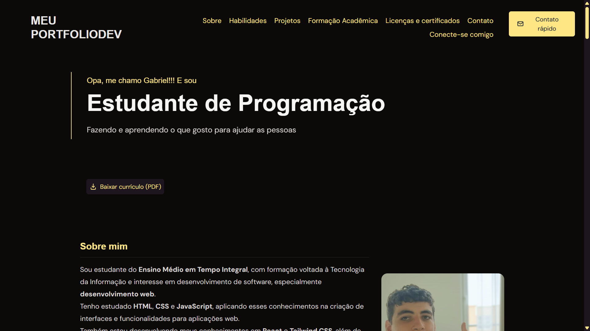

# Portfólio — Gabriel Passos

> Fazendo e aprendendo o que gosto para ajudar as pessoas.

**[Acessar o portfólio](COLE_AQUI_O_LINK_PUBLICADO)** ·
**[Ver meu GitHub](https://github.com/PasteldeSazon)** ·
**[Conectar no LinkedIn](https://www.linkedin.com/in/gabriel-dos-passos/)**

## Antes de começar

Tomei iniciativa de REFAZER este portoflio totalmente, sabe tudo que voce está vendo, é uma versão que foi da água pro vinho em relação ao anterior.

Decidi tomar esta escolha pois percebo que aquele era horrivel, e que tambem queria saber o quanto consegui aprender e evoluir nestes 9 meses (que foi bastante).

### Antes

### Depois 

## Sobre mim

Sou estudante do Ensino Médio em Tempo Integral, com formação voltada à Tecnologia da Informação. Tenho interesse em desenvolvimento web e venho aprendendo por meio de estudos, projetos pessoais e acadêmicos.

Atualmente, participo da Trilha Carreira Tech do SENAI/SC. Quero continuar desenvolvendo minhas habilidades e construir projetos úteis enquanto avanço na minha formação.

## O que você encontra no site

- Apresentação e habilidades
- Projetos com demonstrações e links para os repositórios
- Formação e certificados
- Formas de contato
- Navegação entre seções e formulário de mensagem

## Projetos em destaque

### Tchê Musics

Biblioteca de músicas gaúchas com letras, busca, favoritos e informações sobre autores.

- **Tecnologias:** HTML, CSS, JavaScript e localStorage
- **[Abrir demonstração](https://tche-musics.vercel.app/)**
- **[Ver código](https://github.com/PasteldeSazon/Tche-Musics)**

### Cesta Fácil

Simulação de e-commerce com catálogo, carrinho, busca e fluxo de pagamento fictício.

- **Tecnologias:** React, Tailwind CSS, JavaScript e outras bibliotecas
- **[Abrir demonstração](https://projeto-final-tan.vercel.app/)**
- **[Ver código](https://github.com/PasteldeSazon/PROJETO-FINAL)**

### SkillMatch

Site que sugere vagas com base nas habilidades e experiências informadas pela pessoa.

- **Tecnologias:** HTML, CSS e JavaScript
- **[Abrir demonstração](https://skillmatch-lake-alpha.vercel.app/)**
- **[Ver código](https://github.com/PasteldeSazon/Skill-Match-)**

## Tecnologias do portfólio

- HTML
- CSS
- JavaScript
- Tailwind CSS

## Executar localmente

1. Clone este repositório.
2. Instale as dependências com `npm install`.
3. Gere o CSS com `npm run build:css`.
4. Abra `pages/index.html` usando um servidor local, como Live Server no VS Code.

## Formação e certificados

- Trilha Carreira Tech — SENAI/SC — em andamento
- Introdução à Programação Front-End e Back-End — SENAI/SC
- Introduction to Cybersecurity — Cisco Networking Academy

## Contato

- [GitHub](https://github.com/PasteldeSazon)
- [LinkedIn](https://www.linkedin.com/in/gabriel-dos-passos/)
- [E-mail](mailto:passosgabriel2022@gmail.com)